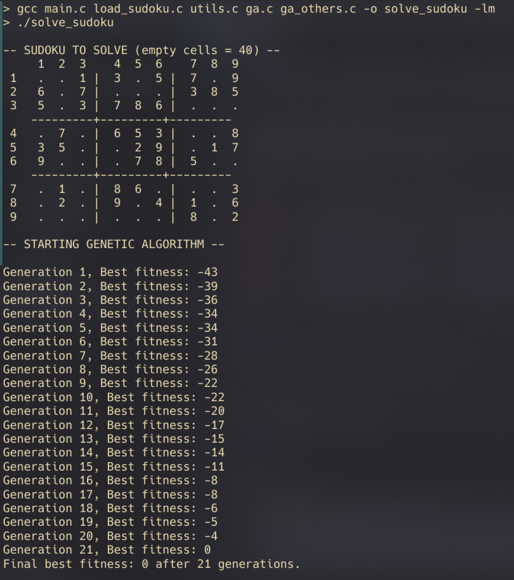
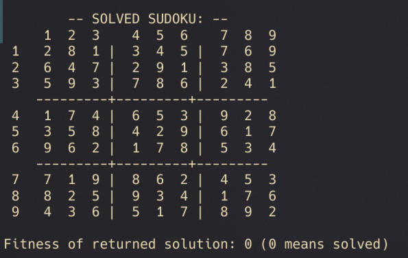

<div align="center">


</div>

# UNI__Genetic-Algorithm-for-Solving-Sudoku

A Sudoku solver written in C that uses the Genetic Algorithm optimization algorithm to find solutions to Sudoku puzzles.
> Compsci course: Second year, second semester
- Main genetic algorithm loop is in [ga.c](https://github.com/werixx1/UNI__Genetic-Algorithm-for-Solving-Sudoku/blob/main/src/ga.c) and different types of crossovers and mutations are in [ga_others.c](https://github.com/werixx1/UNI__Genetic-Algorithm-for-Solving-Sudoku/blob/main/src/ga_others.c)

## Features:
**Types of selections, crossovers and mutations in project:**

- **tournament_selection** = drawing a few individuals and picking the one with the best fitness 
- **roulette_selection** = each individual has a proportionally to their fitness chance to be picked 
- **single_point_crossover** = one crossover point 
- **two_point_crossover** = two crossver points 
- **uniform_crossover** = random parent decision for each cell 
- **square_swap_mutation** = randomly swap two numbers in a square 
- **random_reset_mutation** = each empty cell might be filled with random number

**Fitness** is number of conflicts (same numbers in row, column or square) the lowest number, the closer algorithm is to solution
(0 = no conflicts, solved sudoku)

## Usage

1.  Clone the repository:
    
    ```
    git clone https://github.com/werixx1/UNI__Genetic-Algorithm-for-Solving-Sudoku.git
    cd <project-directory>
    cd src
    ```
    
2.  Execute:
    
    ```
    gcc main.c load_sudoku.c utils.c ga.c ga_others.c -o solve_sudoku -lm
    ./solve_sudoku
    ```
> (skip -lm if using windows)
       
GA solving sudoku |  Solved sudoku
:-------------------------:|:-------------------------:
 |   

## Helpful resources:
- https://www.baeldung.com/cs/elitism-in-evolutionary-algorithms
- https://www.baeldung.com/cs/ga-tournament-selection
- https://www.geeksforgeeks.org/crossover-in-genetic-algorithm/
- https://www.baeldung.com/cs/ga-tournament-selection
- https://learn.microsoft.com/pl-pl/cpp/c-runtime-library/reference/qsort?view=msvc-170


